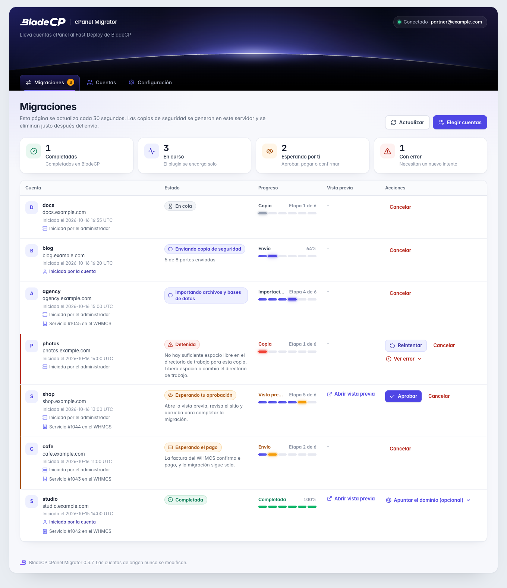
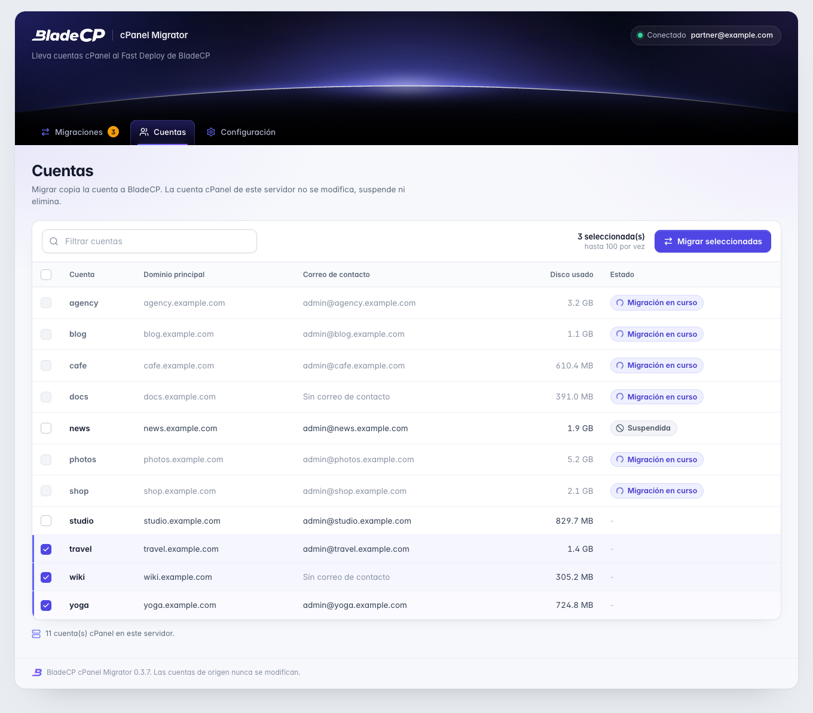
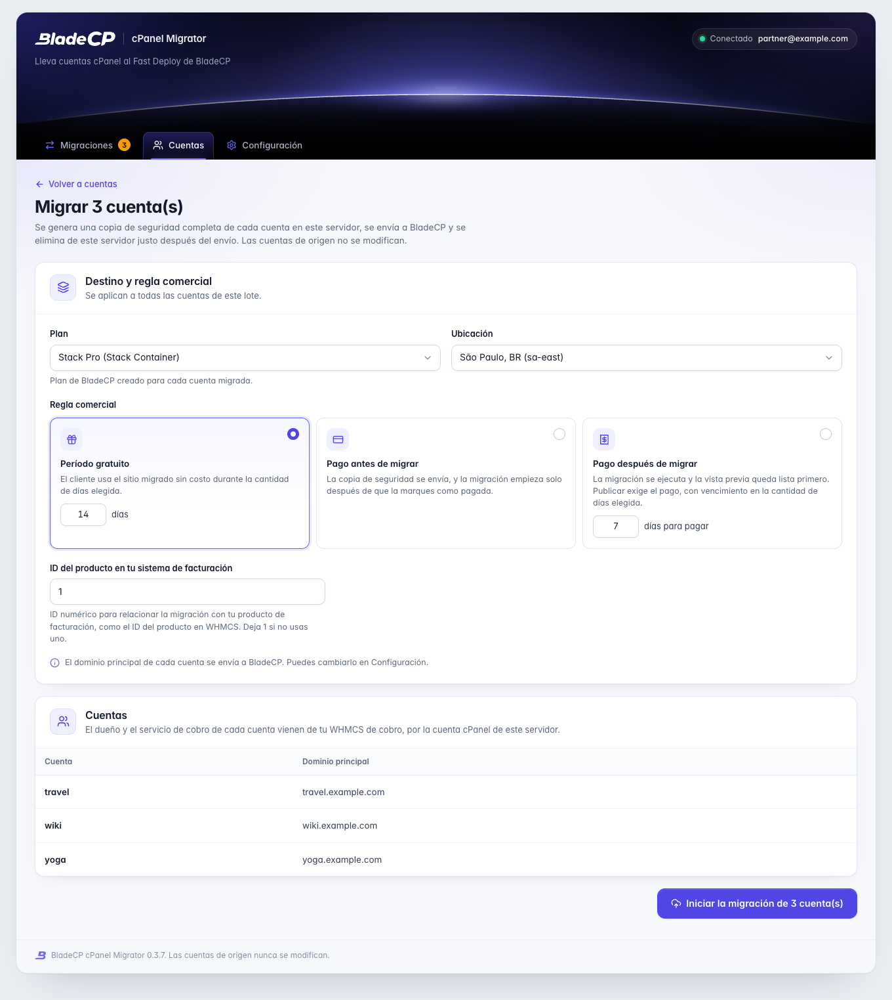
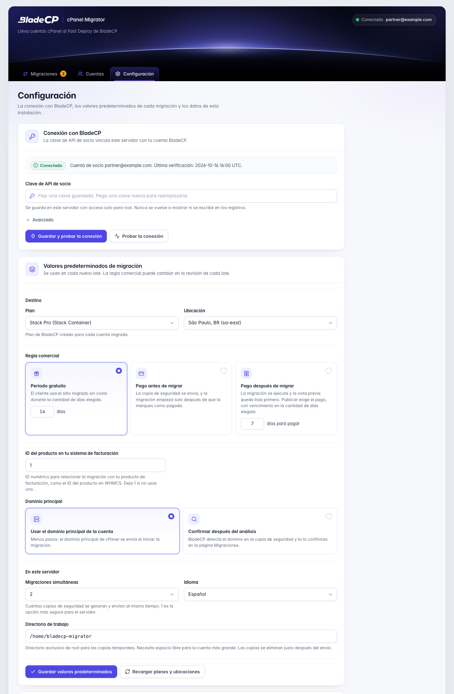
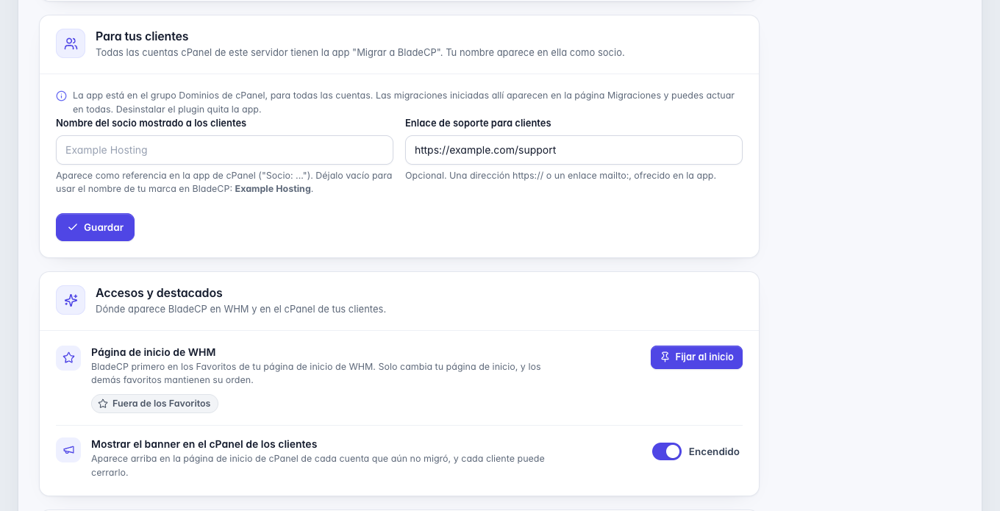
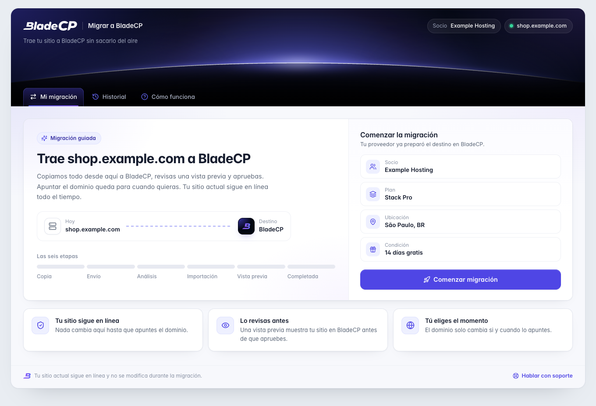
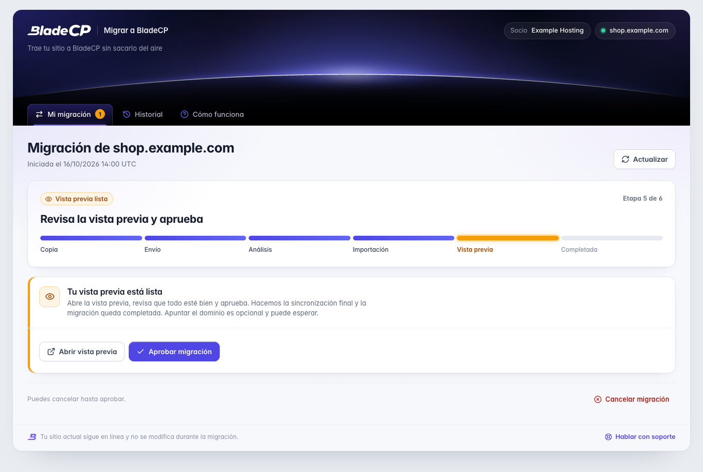
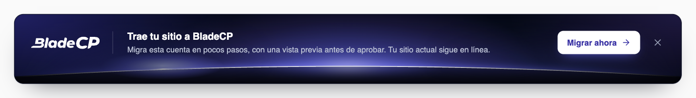

<p align="center">
  <picture>
    <source media="(max-width: 600px)" srcset="assets/hero-compact.es.svg">
    
  </picture>
</p>

<p align="center">
  <strong>Migra cuentas cPanel a BladeCP desde tu WHM, en lote o desde el cPanel de cada cliente.</strong><br>
  El plugin oficial de código abierto que conecta tu servidor cPanel y WHM con la API de socios de BladeCP.
</p>

<p align="center">
  <a href="CHANGELOG.md"></a>
  <a href="#requisitos"></a>
  <a href="#requisitos"></a>
  <a href="#requisitos"></a><br>
  <a href="#calidad"></a>
  <a href="CHANGELOG.md"></a>
  <a href="LICENSE"></a>
  <a href="https://github.com/bladecp/bladecp-cpanel/actions/workflows/ci.yml"></a>
</p>

<p align="center">
  <a href="https://github.com/bladecp/bladecp-cpanel/releases/download/v0.3.7/bladecp-cpanel-migrator-0.3.7.tar.gz"><strong>Descargar BladeCP cPanel Migrator (.tar.gz)</strong></a>
  &nbsp;·&nbsp;
  <a href="https://github.com/bladecp/bladecp-cpanel/releases/tag/v0.3.7">Notas de la versión</a>
  &nbsp;·&nbsp;
  <a href="https://github.com/bladecp/bladecp-cpanel/releases/download/v0.3.7/SHA256SUMS">Suma de comprobación SHA-256</a>
</p>

<p align="center">
  <a href="#funcionalidades">Funcionalidades</a> ·
  <a href="#arquitectura">Arquitectura</a> ·
  <a href="#instalacion">Instalación</a> ·
  <a href="#configuracion">Configuración</a> ·
  <a href="#interfaz">Interfaz</a> ·
  <a href="#documentacion">Documentación</a> ·
  <a href="#seguridad">Seguridad</a> ·
  <a href="#soporte">Soporte</a>
  <br>
  <sub><a href="README.md">English</a> · <a href="README.pt-BR.md">Português (Brasil)</a></sub>
</p>

> [!IMPORTANT]
> **Versión preliminar `0.3.7`.** Es la primera versión pública. Instálala
> primero en un servidor cPanel y WHM que no esté en producción y migra una
> cuenta de prueba antes de llevar cuentas de clientes.

BladeCP cPanel Migrator es el plugin oficial de código abierto de WHM para
empresas de hosting que son socias de BladeCP. Lleva cuentas cPanel de tu
servidor al Fast Deploy de BladeCP: eliges las cuentas en WHM, o tus clientes
empiezan desde su propio cPanel, y BladeCP muestra una vista previa de cada
sitio antes de que lo apruebes.

La cuenta cPanel de origen nunca se modifica, suspende ni elimina. El plugin la
lee, genera el archivo con `pkgacct` y envía ese archivo. El cobro queda en tu
WHMCS, con el addon de BladeCP.

<a id="funcionalidades"></a>

## Creado para socios de BladeCP

| Lotes desde WHM | Una app en cada cPanel | Cobro en tu WHMCS |
| --- | --- | --- |
| Selecciona hasta 100 cuentas, elige la regla comercial y sigue cada migración en una sola página, con el enlace de vista previa y la aprobación. | Tus clientes llevan su propio sitio con el destino que elegiste, desde el grupo **Dominios**, el menú lateral o un banner en la página de inicio de cPanel. | Tu WHMCS de cobro, con el addon de BladeCP, encuentra al titular por la cuenta cPanel y vincula el servicio y la factura. Nadie escribe un correo. |

### Qué pasa con cada cuenta

1. El plugin verifica el espacio libre en disco.
2. Genera una copia de seguridad completa de la cuenta en el servidor con `pkgacct`.
3. Registra la migración en BladeCP con tu clave de API de socio.
4. Envía la copia en partes y, si se interrumpe, continúa desde donde se detuvo.
5. Elimina la copia local justo después del envío.
6. Sigue la migración y muestra el enlace de vista previa, la revisión de dominio, la aprobación y el estado final.

### En WHM

- **Cuentas**: selecciona las cuentas y haz clic en **Migrar seleccionadas**, hasta 100 a la vez. De una a cuatro migraciones se ejecutan al mismo tiempo.
- **Migraciones**: estado, progreso, enlace de vista previa y las acciones de cada migración, con quién la inició, el administrador o la propia cuenta en su cPanel.
- **Configuración**: la conexión con BladeCP, los valores predeterminados de migración, lo que ven tus clientes y los accesos de WHM.
- **Favoritos de WHM**: **Fijar al inicio** pone el plugin primero en tu página de inicio de WHM y mantiene los demás favoritos en su orden. El instalador no fija nada.
- La búsqueda de WHM por "transfer" o "migrar" encuentra **BladeCP: Migrar y Transferir Cuentas**, en el idioma del servidor.

| Acción | Cuándo |
| --- | --- |
| **Confirmar dominio** | BladeCP encontró el dominio principal en la copia de seguridad y necesita tu confirmación. |
| **Aprobar** | La vista previa está lista. Aprobar inicia la sincronización final y la migración queda completada. |
| **Marcar como pagada** | Solo en migraciones creadas antes del vínculo con el WHMCS. En las nuevas, la factura del WHMCS confirma el pago. |
| **Reintentar** | La migración se detuvo con un error, o BladeCP permite un nuevo intento después de una falla. |
| **Cancelar** | Detiene la migración en BladeCP (mientras todavía se pueda cancelar) y elimina la copia local. |
| **Ver error** | Muestra el mensaje, el código, el paso y los detalles del último error. |

### En el cPanel de tus clientes

- Todas las cuentas reciben la app **Migrar a BladeCP**, con el ícono de BladeCP, en el grupo **Dominios** y en el menú lateral.
- Un banner discreto en la página de inicio de cPanel, "Trae tu sitio a BladeCP", lleva a la app. Cada cliente puede cerrarlo para siempre, y desaparece cuando la cuenta ya migró o tiene una migración en curso.
- El cliente inicia la migración de su propia cuenta con el plan, la ubicación, la regla comercial y el manejo de dominio que guardaste. Una migración a la vez por cuenta.
- La app muestra las mismas seis etapas de WHM, la vista previa, la confirmación de dominio y la aprobación. Los errores aparecen en lenguaje simple, con un código corto para tu soporte.
- Cuando tu WHMCS todavía no conoce la cuenta, la app pide al cliente confirmarla en tu área de cliente del WHMCS, en una pestaña nueva, y sigue sola.
- El cliente puede cancelar hasta aprobar. El pago y el nuevo intento quedan contigo, en WHM.

### Apuntar el dominio es opcional

Después de la aprobación la migración queda **Completada**. Apuntar el dominio
nunca es una etapa: **Apuntar el dominio (opcional)** muestra los nameservers
de BladeCP, con botón de copiar, y el registro A como alternativa. Cuando el
dominio apunta, la página lo muestra.

## Arquitectura

El plugin separa las pantallas en las que tú y tus clientes actúan, el trabajo
que se ejecuta cada minuto y la comunicación con BladeCP. La cuenta de origen
solo se lee y se archiva.

<p align="center">
  <picture>
    <source media="(max-width: 600px)" srcset="assets/architecture-compact.es.svg">
    
  </picture>
</p>

<p align="center"><sub>Vista lógica del plugin. <a href="assets/architecture.es.svg">Abrir el diagrama en tamaño real</a>.</sub></p>

### De WHM al sitio migrado

1. **Tú o tu cliente empiezan.** En WHM, solo `root` abre el plugin, y cada
   formulario lleva un token CSRF ligado a la sesión de WHM. En cPanel, la
   página de la app se ejecuta como la cuenta y pasa por UAPI hasta un
   AdminBin que se ejecuta como root y actúa solo en la cuenta que cPanel
   autenticó.
2. **La cola mantiene el orden.** Cada migración entra en la cola con su propio
   bloqueo. Un cron ejecuta el worker cada minuto, hasta cuatro migraciones a
   la vez, y el worker mantiene las marcas del banner de cada cuenta.
3. **La copia sale en partes.** `pkgacct` escribe una copia completa en un
   directorio de trabajo solo de root. El envío usa enlaces firmados, continúa
   desde la primera parte que faltó y borra la copia al terminar.
4. **BladeCP arma la vista previa.** El cliente de la API llama a
   `api.bladecp.com` por HTTPS con tu clave de socio, sigue la migración y trae
   el enlace de vista previa, la revisión de dominio y la aprobación.
5. **El cobro queda en tu WHMCS.** El addon de BladeCP de tu WHMCS de cobro
   vincula el titular, el servicio y la factura. Apuntar el dominio es
   opcional.

| Capa | Responsabilidad |
| --- | --- |
| **Plugin de WHM** | Cuentas, lotes, migraciones, configuración y Favoritos de WHM, solo para `root` |
| **App de cPanel** | Página de Jupiter, módulo UAPI y AdminBin de root, limitado a la cuenta conectada |
| **Cola y worker** | Bloqueos, reintentos, de una a cuatro migraciones a la vez y las marcas del banner |
| **Copia y envío** | Archivo de `pkgacct`, verificación de espacio en disco y envío reanudable por enlaces firmados |
| **Cliente de la API** | Clave de socio solo en el encabezado `Authorization`, con registros sin secretos |
| **Datos del plugin** | Directorio solo de root con configuración, cola y registros |

<a id="descargas"></a>

## Descargas y notas de la versión

**`0.3.7`** es la primera versión pública. Se instala desde la release de
GitHub, con un archivo determinista verificado por la suma de comprobación
publicada, y el período gratuito predeterminado pasa a ser de 14 días, como se
describe en el [changelog](CHANGELOG.md). Lee las notas de la versión antes de
actualizar.

| Archivo | Propósito |
| --- | --- |
| [**bladecp-cpanel-migrator-0.3.7.tar.gz**](https://github.com/bladecp/bladecp-cpanel/releases/download/v0.3.7/bladecp-cpanel-migrator-0.3.7.tar.gz) | Paquete instalable, con `install.sh`, `uninstall.sh` y `plugin/` |
| [**SHA256SUMS**](https://github.com/bladecp/bladecp-cpanel/releases/download/v0.3.7/SHA256SUMS) | Suma de comprobación para verificar la integridad del archivo |
| [**bladecp-cpanel-migrator-0.3.7.tar.gz.sha256**](https://github.com/bladecp/bladecp-cpanel/releases/download/v0.3.7/bladecp-cpanel-migrator-0.3.7.tar.gz.sha256) | La misma suma, junto al nombre del archivo |
| [**RELEASE_NOTES.md**](https://github.com/bladecp/bladecp-cpanel/releases/download/v0.3.7/RELEASE_NOTES.md) | Notas que acompañan este paquete |

Consulta la [página de la release](https://github.com/bladecp/bladecp-cpanel/releases/tag/v0.3.7)
o [todas las releases de BladeCP cPanel Migrator](https://github.com/bladecp/bladecp-cpanel/releases).
Los archivos automáticos **Source code** de GitHub contienen el repositorio;
para instalar el plugin, usa el `.tar.gz` de la lista anterior.

<a id="requisitos"></a>

## Requisitos y compatibilidad

| Componente | Requisito |
| --- | --- |
| cPanel y WHM | Una versión actual, con acceso root. La app de cPanel, su entrada en el menú lateral y el banner de la página de inicio necesitan el tema Jupiter. |
| PHP | El PHP incluido en cPanel (`/usr/local/cpanel/3rdparty/bin/php`), 8.1 o posterior, con las extensiones curl y json |
| Perl | El Perl incluido en cPanel, para el módulo UAPI y el AdminBin |
| Sistema | El cron del sistema leyendo `/etc/cron.d`, además de `pkgacct`, `setsid`, `nice` y `pkill` |
| Red | HTTPS de salida a `api.bladecp.com` y al almacenamiento de copias de BladeCP |
| Disco | Espacio libre para la cuenta más grande que migres a la vez, más 2 GB, en el directorio de trabajo |
| Cobro | Tu WHMCS de cobro con el addon de BladeCP |
| Idiomas | Inglés, portugués (Brasil) y español, en WHM y en la app de cPanel |

La versión `0.3.7` se validó en cPanel y WHM 11.138 con AlmaLinux 9 y el PHP
8.4 incluido en cPanel. Son entornos probados, no requisitos mínimos
adicionales.

También necesitas:

- Una cuenta de socio de BladeCP.
- Una clave de API de socio con permisos de migración (`migrations:read` y
  `migrations:write`, o `provisions:read` y `provisions:write`).
- Al menos un plan de socio que acepte migraciones.

<a id="instalacion"></a>

## Instalación rápida

Instala desde una [release de GitHub](https://github.com/bladecp/bladecp-cpanel/releases),
no desde una copia del código fuente. El servidor no necesita Composer ni una
etapa de build.

1. Como root, descarga la release y el archivo `SHA256SUMS`, verifica el
   archivo y ejecuta el instalador:

   ```bash
   curl -fLO https://github.com/bladecp/bladecp-cpanel/releases/download/v0.3.7/bladecp-cpanel-migrator-0.3.7.tar.gz
   curl -fLO https://github.com/bladecp/bladecp-cpanel/releases/download/v0.3.7/SHA256SUMS
   sha256sum -c SHA256SUMS
   tar -xzf bladecp-cpanel-migrator-0.3.7.tar.gz
   cd bladecp-cpanel-migrator-0.3.7
   ./install.sh
   ```

   `sha256sum -c SHA256SUMS` debe mostrar `OK` para el archivo.

2. Abre WHM, ve a **Plugins** y elige **BladeCP: Migrar y Transferir
   Cuentas**. El nombre sigue el idioma del servidor.
3. Abre **Configuración**, pega tu clave de API de socio y guarda los valores
   predeterminados de migración. Después, migra una cuenta de prueba.

El instalador registra el plugin en WHM, crea un cron que se ejecuta cada
minuto, instala la app de cPanel para el tema Jupiter y guarda la
configuración, la cola y los registros en `/var/cpanel/bladecp-migrator`, solo
para root. La lista completa de rutas está en la
[guía de instalación](docs/installation.md#what-the-installer-creates), en
inglés.

### Actualización y desinstalación

Descarga y verifica la nueva release, extrae el archivo y ejecuta de nuevo su
`install.sh`. La configuración, la clave de API y la cola de migraciones se
mantienen.

```bash
/usr/local/bladecp-migrator/uninstall.sh
```

La desinstalación elimina los archivos del plugin, el cron, el registro en
WHM, la app de cPanel con su entrada en el menú lateral y el banner, y las
copias temporales. Agrega `--purge` para eliminar también la configuración, el
historial de migraciones y la clave de API. Nunca elimina un include de otro
sistema y no cancela las migraciones que ya están en curso en BladeCP.

<a id="configuracion"></a>

## Configuración

Abre **Configuración** en el plugin.

| Sección | Qué defines |
| --- | --- |
| **Conexión con BladeCP** | Pega la clave de API de socio y haz clic en **Guardar y probar la conexión**. El plugin muestra la cuenta de socio conectada. |
| **Valores predeterminados de migración** | Plan y ubicación, regla comercial, ID del producto en tu sistema de facturación, manejo del dominio principal, migraciones simultáneas (de 1 a 4), directorio de trabajo e idioma |
| **Para tus clientes** | El nombre del socio que la app de cPanel muestra como referencia y un enlace de soporte opcional |
| **Accesos y destacados** | Fijar el plugin en los Favoritos de WHM, y mostrar u ocultar el banner en el cPanel de tus clientes |

La clave se guarda en un archivo solo de root, con modo 0600, nunca se vuelve
a mostrar y nunca se escribe en los registros. Deja vacía la URL personalizada
de la API en **Avanzado**, salvo que el soporte de BladeCP te pida cambiarla.

### Reglas comerciales

| Regla | Comportamiento |
| --- | --- |
| **Período gratuito** | La migración llega a la vista previa y se puede aprobar de inmediato. El cliente tiene la cantidad de días gratuitos elegida, 14 de forma predeterminada. |
| **Pago antes de migrar** | La copia de seguridad se envía, pero la migración empieza solo después de pagar la factura del WHMCS. |
| **Pago después de migrar** | La migración llega a la vista previa. La aprobación exige la factura del WHMCS pagada, con vencimiento en la cantidad de días elegida. |

Puedes cambiar la regla en cada migración. La
[guía de configuración](docs/configuration.md), en inglés, cubre cada campo y
la línea de comandos.

<a id="interfaz"></a>

## Míralo en WHM y cPanel

<p align="center">
  
</p>

<p align="center"><sub>Migraciones en WHM: cada cuenta con su etapa, el enlace de vista previa y la acción que necesita.</sub></p>

| Cuentas, con tres seleccionadas | Revisión del lote |
| --- | --- |
|  |  |

| Configuración: conexión y valores predeterminados | Configuración: clientes, accesos y destacados |
| --- | --- |
|  |  |

| App de cPanel: antes de la migración | App de cPanel: vista previa lista para aprobar |
| --- | --- |
|  |  |

<p align="center">
  
</p>

<p align="center"><sub>El banner arriba en la página de inicio de cPanel, hasta que la cuenta migra o el cliente lo cierra.</sub></p>

Las capturas vienen del código del plugin `0.3.7`, renderizado con datos
neutros de demostración, como `example.com`, y con los estilos del tema Jupiter
de cPanel alrededor del banner. En un servidor, las mismas pantallas se abren
dentro de WHM y de cPanel.

### Dónde aparece

| Lugar | Qué ven tú y tus clientes |
| --- | --- |
| **WHM → Plugins** | **BladeCP: Migrar y Transferir Cuentas**, con el ícono de BladeCP, también encontrado por la búsqueda de WHM |
| **Página de inicio de WHM** | El plugin primero en tus Favoritos, cuando eliges **Fijar al inicio** |
| **Páginas del plugin** | **Cuentas**, **Migraciones** y **Configuración**, bajo el encabezado con el horizonte de BladeCP |
| **cPanel → Dominios** | La app **Migrar a BladeCP**, con el ícono de BladeCP |
| **Menú lateral de cPanel** | La misma app, con la "B" de BladeCP en el color de los íconos nativos del menú |
| **Página de inicio de cPanel** | El banner "Trae tu sitio a BladeCP" con **Migrar ahora**, hasta que la cuenta migra o el cliente lo cierra |

Cada pantalla sigue el idioma del servidor o de la cuenta cPanel, en inglés,
portugués (Brasil) o español, y respeta la preferencia de movimiento reducido.

<a id="documentacion"></a>

## Documentación

Las guías están en inglés.

| Guía | Qué encontrarás |
| --- | --- |
| [Instalación](docs/installation.md) | Descarga, suma de comprobación, rutas del instalador, actualización y desinstalación |
| [Configuración](docs/configuration.md) | Conexión, valores predeterminados, reglas comerciales, accesos y línea de comandos |
| [Compatibilidad](docs/compatibility.md) | Requisitos, entorno validado y lo que todavía no se admite |
| [Solución de problemas](docs/troubleshooting.md) | Worker, conexión, planes, migraciones detenidas, app de cPanel y registros |
| [Proceso de release](docs/release-process.md) | Cómo se preparan y verifican las versiones públicas |
| [Gobernanza del repositorio](docs/repository-governance.md) | Issues, pull requests, historial y releases |
| [Changelog](CHANGELOG.md) | Cambios de cada versión |
| [Política de seguridad](SECURITY.md) | Reporte privado de vulnerabilidades |
| [Cómo contribuir](CONTRIBUTING.md) | Cómo proponer y validar un cambio |

<a id="seguridad"></a>

## Seguridad

- **Solo root en WHM.** Solo el usuario `root` de WHM abre el plugin. Cada
  formulario está protegido por el token de sesión de WHM y por un token CSRF
  ligado a esa sesión, y las solicitudes de otro origen se rechazan.
- **Una cuenta por cliente.** La app de cPanel no guarda secretos. Cada acción
  pasa por UAPI hasta un AdminBin que actúa solo en la cuenta que cPanel
  autenticó, nunca en un nombre enviado por la página. Las solicitudes tienen
  límite por cuenta, y los inicios y acciones quedan en el registro.
- **Un lugar para la clave.** La clave de API de socio se guarda solo para
  root, se envía únicamente en el encabezado `Authorization` y se elimina de
  los registros y de los detalles de error.
- **Copias de vida corta.** Las copias van a un directorio solo de root y se
  eliminan justo después del envío exitoso, al cancelar y al desinstalar.
- **El origen queda intacto.** El plugin nunca modifica, suspende ni elimina la
  cuenta de origen.

Para reportar una vulnerabilidad de forma privada, sigue
[SECURITY.md](SECURITY.md). No incluyas claves de API, copias de seguridad ni
datos de clientes en un issue público.

<a id="calidad"></a>

## Calidad y validación

La versión `0.3.7` fue validada por los mantenedores con **769 verificaciones
automatizadas**: 649 verificaciones unitarias y de escenario de la cola, el
worker, el envío, el cliente de la API, la configuración, las pantallas de WHM
y de cPanel y la eliminación de secretos, 18 verificaciones en Perl del módulo
UAPI y del AdminBin, 81 verificaciones de instalación y desinstalación en una
raíz de sistema simulada y las 21 verificaciones públicas de regresión. La
insignia de pruebas representa esa ejecución.

Antes de generar el paquete, cada archivo PHP pasa una verificación de
sintaxis y el árbol público se revisa en busca de credenciales y referencias no
públicas. El archivo de la release se instaló después desde cero en un
servidor cPanel y WHM 11.138, se conectó, se desinstaló sin residuos y se
instaló de nuevo.

Este repositorio incluye sus propias verificaciones de regresión
(`tests/run.php`), las verificaciones de Perl y de instalación
(`tests/perl/run.sh` y `tests/install/run.sh`) y la verificación de estructura
e higiene (`scripts/check-public-tree.sh`). El
[CI público](https://github.com/bladecp/bladecp-cpanel/actions/workflows/ci.yml)
las ejecuta en PHP 8.1, 8.2, 8.3 y 8.4. Las verificaciones automatizadas no
reemplazan una prueba en tu propio servidor antes de usarlo con clientes.

<a id="desarrollo"></a>

## Desarrollo y contribución

El plugin es PHP 8.1 puro, con autoloader nativo: no hay etapa de build ni
dependencia de Composer.

```sh
git clone https://github.com/bladecp/bladecp-cpanel.git
cd bladecp-cpanel
find plugin tests -type f \( -name '*.php' -o -name '*.cgi' \) -print0 | xargs -0 -n1 php -l
php tests/run.php
bash tests/perl/run.sh
PHP=php bash tests/install/run.sh
bash scripts/check-public-tree.sh
```

```text
plugin/
  src/                Cola, worker, envío, cliente de la API, pantallas de WHM y backend de la app de cPanel
  cgi/                Punto de entrada en WHM
  bin/                Worker y el comando privilegiado de la app de cPanel
  cpanel/             App de cPanel: página de Jupiter, módulo UAPI, AdminBin y entrada de menú
  lang/               Inglés, portugués (Brasil) y español
  assets/             Estilos, íconos y la fuente Inter
install.sh            Instalador y actualizador
uninstall.sh          Desinstalador (--purge elimina también los datos)
tests/                Verificaciones públicas de regresión, Perl e instalación
scripts/              Verificación pública de estructura e higiene
docs/                 Guías de instalación, configuración y operación
assets/               Arte, capturas de pantalla y marcas del README
```

Las contribuciones son bienvenidas. Lee [CONTRIBUTING.md](CONTRIBUTING.md)
antes de abrir un issue o un pull request, mantén los cambios enfocados, agrega
la cobertura pertinente y nunca envíes credenciales ni datos de clientes. Las
contribuciones aprobadas siguen el flujo de mantenimiento del proyecto antes de
aparecer en una versión pública posterior.

<a id="preguntas"></a>

## Preguntas frecuentes

<details>
<summary><strong>¿El plugin modifica la cuenta de origen?</strong></summary>

No. Lee la cuenta y genera el archivo con `pkgacct`. La cuenta nunca se
modifica, suspende ni elimina, y la copia local se borra después del envío.

</details>

<details>
<summary><strong>¿Necesito Composer o una etapa de build en el servidor?</strong></summary>

No. El `.tar.gz` trae `install.sh`, `uninstall.sh` y `plugin/`. Ejecuta el
instalador como root y el plugin queda listo para configurar.

</details>

<details>
<summary><strong>¿Mis clientes pueden iniciar una migración por su cuenta?</strong></summary>

Sí, desde la app **Migrar a BladeCP** en su cPanel, con los valores
predeterminados que guardaste. Cada cuenta ve y actúa solo en su propia
migración. Para ocultar la app a una cuenta, desactiva la función
`site_migration` en el Feature Manager.

</details>

<details>
<summary><strong>¿Y si el envío se interrumpe?</strong></summary>

No hay que hacer nada. El siguiente intento continúa desde la primera parte que
faltó.

</details>

<details>
<summary><strong>¿Quién cobra al cliente migrado?</strong></summary>

Tú, en tu WHMCS. El addon de BladeCP encuentra al titular por la cuenta cPanel
y vincula el servicio y la factura. Con **Pago antes de migrar** o **Pago
después de migrar**, la factura del WHMCS confirma el pago.

</details>

<details>
<summary><strong>¿La migración espera a que se apunte el dominio?</strong></summary>

No. La migración queda completada cuando apruebas la vista previa. Apuntar el
dominio, con los nameservers de BladeCP o un registro A, es opcional.

</details>

<a id="soporte"></a>

## Soporte

| Asunto | Canal |
| --- | --- |
| Error reproducible o pedido de producto | [GitHub Issues](https://github.com/bladecp/bladecp-cpanel/issues) |
| Soporte técnico y de producto | [dev@bladecp.com](mailto:dev@bladecp.com) |
| Vulnerabilidad | [Política de seguridad](SECURITY.md) |
| Documentación en línea | [developers.bladecp.com](https://developers.bladecp.com/es/cpanel-migrator) |

En reportes públicos, usa datos neutros, como `example.com`. Mantén las claves
de API, las copias de seguridad y la información de clientes en canales
privados.

## Licencia

BladeCP cPanel Migrator se distribuye bajo la [Licencia MIT](LICENSE). La
fuente Inter en `plugin/assets/fonts` mantiene su propia
[SIL Open Font License](plugin/assets/fonts/LICENSE.txt). La licencia del
plugin no sustituye la licencia de cPanel y WHM ni las condiciones de los
servicios de BladeCP.

<p align="center"><strong>BladeCP. Tu tienda, nuestra infraestructura.</strong></p>
