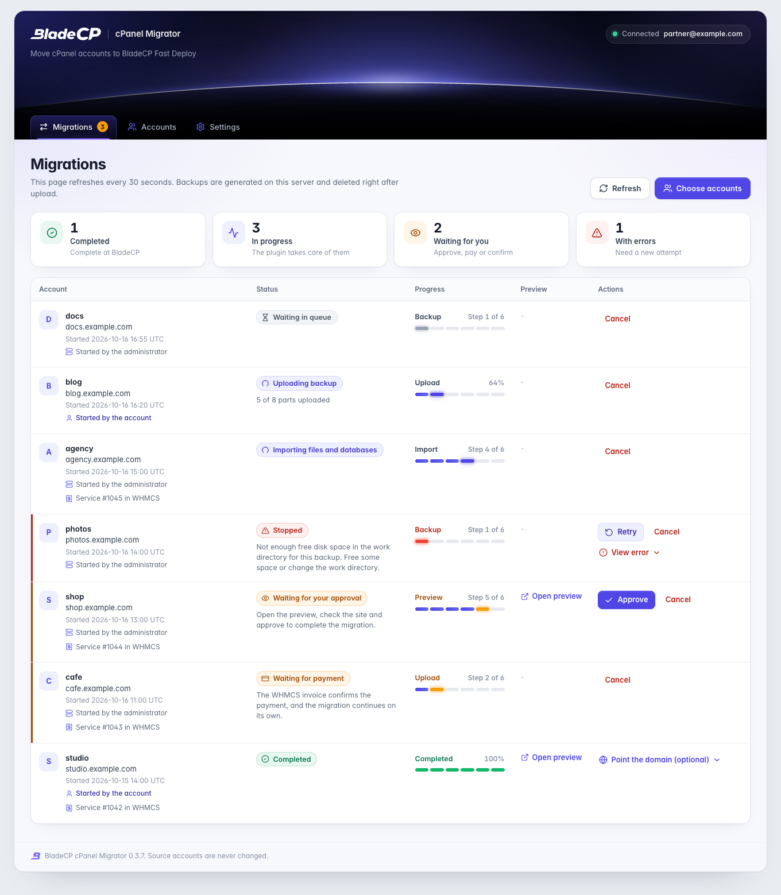
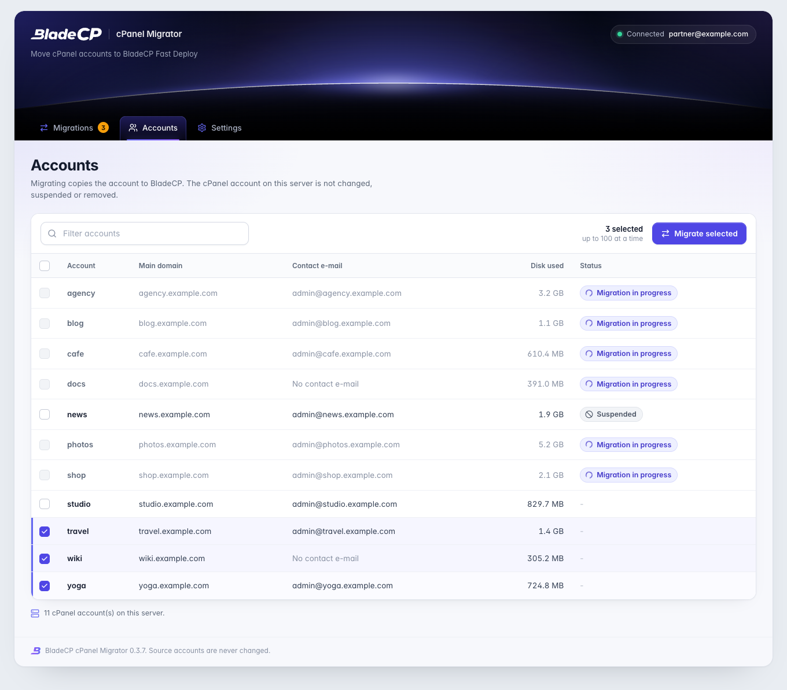
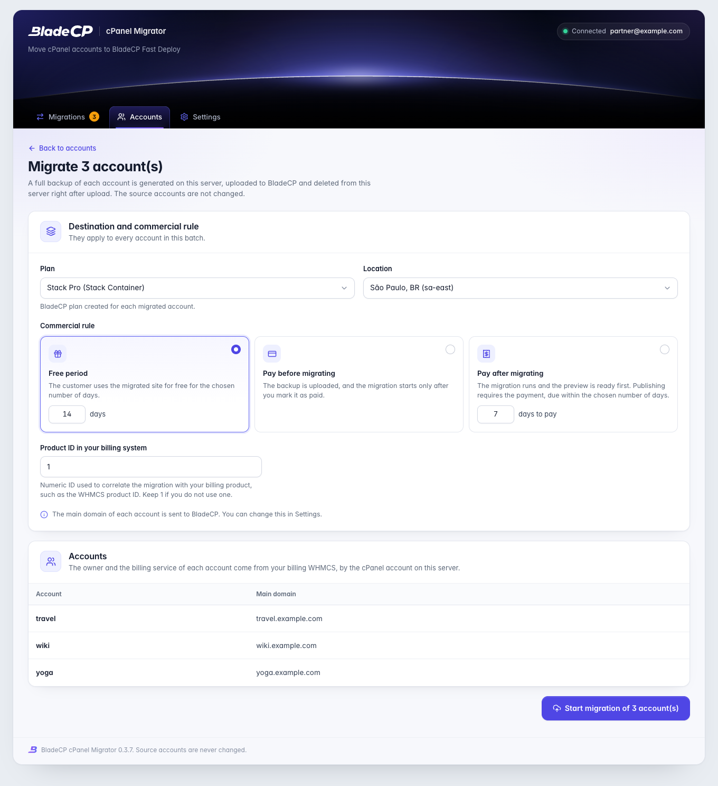
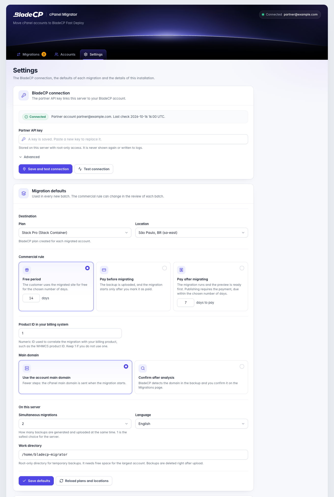
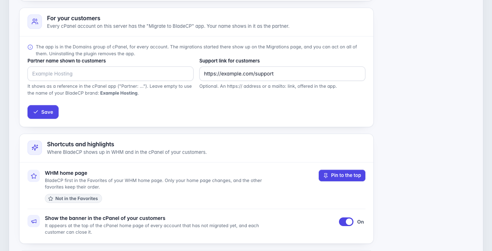
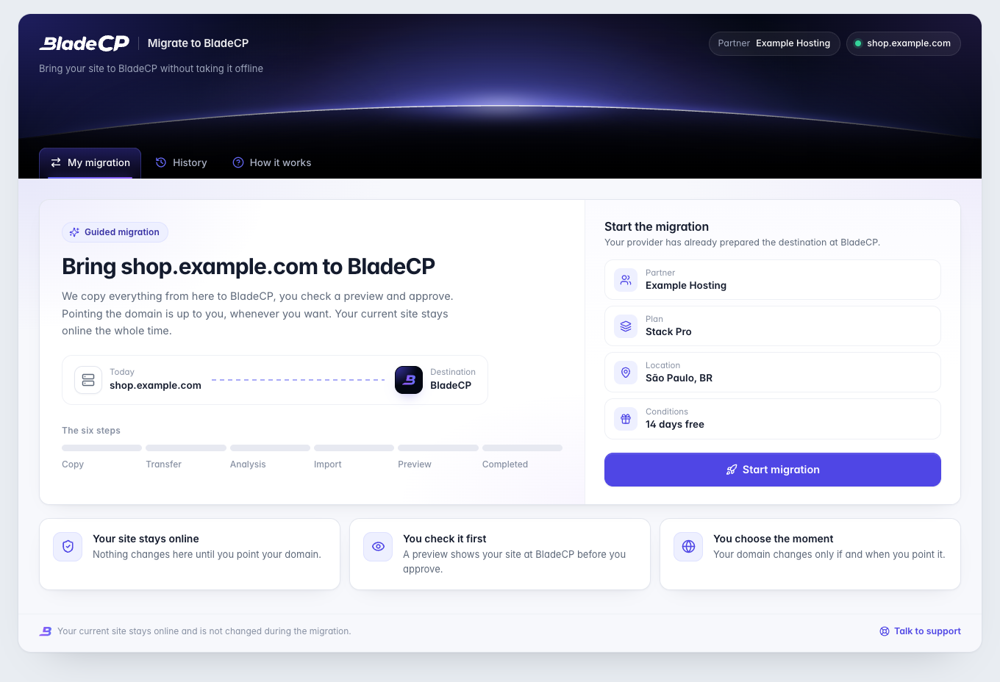
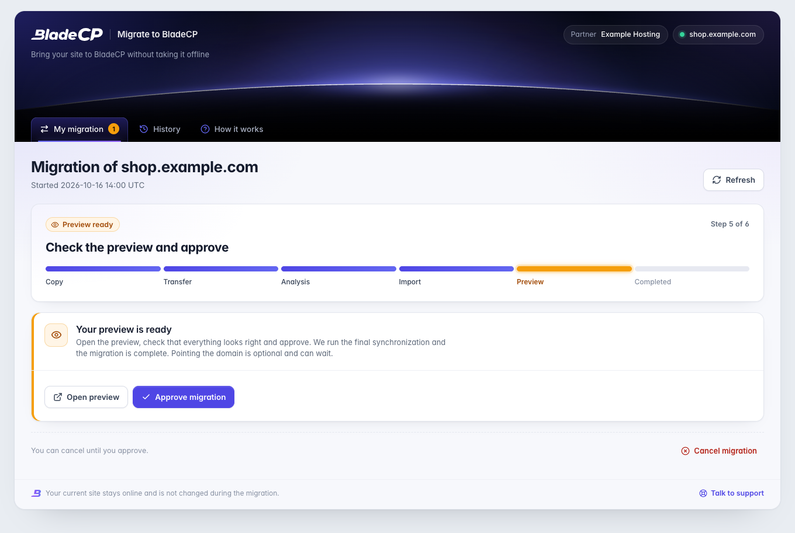

<p align="center">
  <picture>
    <source media="(max-width: 600px)" srcset="assets/hero-compact.en.svg">
    
  </picture>
</p>

<p align="center">
  <strong>Migrate cPanel accounts to BladeCP from your WHM, in batches or from the cPanel of each customer.</strong><br>
  The official open-source plugin that connects your cPanel &amp; WHM server to the BladeCP partner API.
</p>

<p align="center">
  <a href="CHANGELOG.md"></a>
  <a href="#requirements"></a>
  <a href="#requirements"></a>
  <a href="#requirements"></a><br>
  <a href="#quality"></a>
  <a href="CHANGELOG.md"></a>
  <a href="LICENSE"></a>
  <a href="https://github.com/bladecp/bladecp-cpanel/actions/workflows/ci.yml"></a>
</p>

<p align="center">
  <a href="https://github.com/bladecp/bladecp-cpanel/releases/download/v0.3.8/bladecp-cpanel-migrator-0.3.8.tar.gz"><strong>Download BladeCP cPanel Migrator (.tar.gz)</strong></a>
  &nbsp;·&nbsp;
  <a href="https://github.com/bladecp/bladecp-cpanel/releases/tag/v0.3.8">Release notes</a>
  &nbsp;·&nbsp;
  <a href="https://github.com/bladecp/bladecp-cpanel/releases/download/v0.3.8/SHA256SUMS">SHA-256 checksum</a>
</p>

<p align="center">
  <a href="#features">Features</a> ·
  <a href="#architecture">Architecture</a> ·
  <a href="#installation">Installation</a> ·
  <a href="#configuration">Configuration</a> ·
  <a href="#interface">Interface</a> ·
  <a href="#documentation">Documentation</a> ·
  <a href="#security">Security</a> ·
  <a href="#support">Support</a>
  <br>
  <sub><a href="README.pt-BR.md">Português (Brasil)</a> · <a href="README.es.md">Español</a></sub>
</p>

> [!IMPORTANT]
> **Pre-release `0.3.8`.** Install it on a
> non-production cPanel &amp; WHM server first, and migrate a test account
> before moving customer accounts.

BladeCP cPanel Migrator is the official open-source WHM plugin for hosting
companies that are BladeCP partners. It moves cPanel accounts from your server
to BladeCP Fast Deploy: you pick the accounts in WHM, or your customers start
from their own cPanel, and BladeCP shows a preview of each site before you
approve it.

The source cPanel account is never changed, suspended or removed. The plugin
reads it, archives it with `pkgacct` and uploads the archive. Billing stays in
your WHMCS, with the BladeCP addon.

<a id="features"></a>

## Built for BladeCP partners

| Batches from WHM | An app in every cPanel | Billing in your WHMCS |
| --- | --- | --- |
| Select up to 100 accounts, choose the commercial rule and follow every migration on one page, with the preview link and the approval. | Your customers move their own site with the destination you chose, from the **Domains** group, the side menu or a banner on the cPanel home page. | Your billing WHMCS, with the BladeCP addon, finds the owner by the cPanel account and links the service and the invoice. Nobody types an e-mail. |

### What happens to each account

1. The plugin checks the free disk space.
2. It generates a full account backup on the server with `pkgacct`.
3. It registers the migration at BladeCP with your partner API key.
4. It uploads the backup in parts, resuming where it stopped after an interruption.
5. It deletes the local backup right after the upload.
6. It follows the migration and shows the preview link, the domain review, the approval and the final status.

### In WHM

- **Accounts**: select accounts and click **Migrate selected**, up to 100 at a time. One to four migrations run at the same time.
- **Migrations**: status, progress, preview link and the actions of each migration, with who started it, the administrator or the account in its cPanel.
- **Settings**: the BladeCP connection, migration defaults, what your customers see and the WHM shortcuts.
- **WHM Favorites**: **Pin to the top** puts the plugin first on your WHM home page and keeps your other favorites in their order. The installer pins nothing.
- Searching WHM for "transfer" or "migrate" finds **BladeCP: Migrate and Transfer Accounts**, in the language of the server.

| Action | When |
| --- | --- |
| **Confirm domain** | BladeCP found the main domain in the backup and needs your confirmation. |
| **Approve** | The preview is ready. Approving starts the final synchronization, and the migration is complete. |
| **Mark as paid** | Only for migrations created before the WHMCS billing link. In the new ones the WHMCS invoice confirms the payment. |
| **Retry** | The migration stopped with an error, or BladeCP allows a new attempt after a failure. |
| **Cancel** | Stops the migration at BladeCP (while it can still be cancelled) and removes the local backup. |
| **View error** | Shows the message, code, step and details of the last error. |

### In the cPanel of your customers

- Every account gets the **Migrate to BladeCP** app, with the BladeCP icon, in the **Domains** group and in the side menu.
- A small banner on the cPanel home page, "Bring your site to BladeCP", leads to the app. Each customer can close it for good, and it hides once the account migrated or has a migration going on.
- The customer starts the migration of their own account with the plan, location, commercial rule and domain handling you saved. One migration at a time per account.
- The app shows the same six stages as WHM, the preview, the domain confirmation and the approval. Errors are in plain language, with a short code for your support.
- When your WHMCS does not know the account yet, the app asks the customer to confirm it in your WHMCS client area, in a new tab, and continues on its own.
- The customer can cancel until they approve. Payment and retry stay with you, in WHM.

### Pointing the domain is optional

After the approval the migration is **Completed**. Pointing the domain is never
a step: **Point the domain (optional)** shows the BladeCP nameservers, with a
copy button, and the A record as an alternative. When the domain points, the
page says so.

## Architecture

The plugin separates the screens where you and your customers act, the work
that runs every minute and the communication with BladeCP. The source account
is only read and archived.

<p align="center">
  <picture>
    <source media="(max-width: 600px)" srcset="assets/architecture-compact.en.svg">
    
  </picture>
</p>

<p align="center"><sub>Logical view of the plugin. <a href="assets/architecture.en.svg">Open the diagram at full size</a>.</sub></p>

### From WHM to the migrated site

1. **You or your customer start.** In WHM, only `root` opens the plugin, and
   every form carries a CSRF token bound to the WHM session. In cPanel, the app
   page runs as the account and goes through UAPI to an AdminBin that runs as
   root and acts only on the account cPanel authenticated.
2. **The queue keeps the order.** Each migration enters the queue with its own
   lock. A cron runs the worker every minute, up to four migrations at a time,
   and the worker keeps the banner marks of each account.
3. **The backup leaves in parts.** `pkgacct` writes a full backup to a
   root-only work directory. The upload uses signed links, resumes from the
   first missing part and deletes the backup when it finishes.
4. **BladeCP builds the preview.** The API client calls `api.bladecp.com` over
   HTTPS with your partner key, follows the migration and brings back the
   preview link, the domain review and the approval.
5. **Billing stays in your WHMCS.** The BladeCP addon of your billing WHMCS
   links the owner, the service and the invoice. Pointing the domain is
   optional.

| Layer | Responsibility |
| --- | --- |
| **WHM plugin** | Accounts, batches, migrations, settings and the WHM Favorites, for `root` only |
| **cPanel app** | Jupiter page, UAPI module and root AdminBin, limited to the signed-in account |
| **Queue and worker** | Locks, retries, one to four migrations at a time and the banner marks |
| **Backup and upload** | `pkgacct` archive, free disk check and resumable upload on signed links |
| **API client** | Partner key in the `Authorization` header only, with redacted logs |
| **Plugin data** | Root-only directory with settings, queue and logs |

<a id="download"></a>

## Downloads and release notes

**`0.3.8`** turns **Confirm my account** in the cPanel app into a link, so
browsers that apply the form-action policy to redirects, such as Chrome, no
longer block it, and hardens the API settings, the queue and the work
directory, as described in the [changelog](CHANGELOG.md). It installs from the
GitHub release with a deterministic archive verified by its published
checksum. Review the release notes before upgrading.

| File | Purpose |
| --- | --- |
| [**bladecp-cpanel-migrator-0.3.8.tar.gz**](https://github.com/bladecp/bladecp-cpanel/releases/download/v0.3.8/bladecp-cpanel-migrator-0.3.8.tar.gz) | Installable package, with `install.sh`, `uninstall.sh` and `plugin/` |
| [**SHA256SUMS**](https://github.com/bladecp/bladecp-cpanel/releases/download/v0.3.8/SHA256SUMS) | Checksum to verify the integrity of the archive |
| [**bladecp-cpanel-migrator-0.3.8.tar.gz.sha256**](https://github.com/bladecp/bladecp-cpanel/releases/download/v0.3.8/bladecp-cpanel-migrator-0.3.8.tar.gz.sha256) | The same checksum, next to the archive name |
| [**RELEASE_NOTES.md**](https://github.com/bladecp/bladecp-cpanel/releases/download/v0.3.8/RELEASE_NOTES.md) | Notes that accompany this package |

See the [release page](https://github.com/bladecp/bladecp-cpanel/releases/tag/v0.3.8)
or [all BladeCP cPanel Migrator releases](https://github.com/bladecp/bladecp-cpanel/releases).
The automatic **Source code** archives from GitHub contain the repository; to
install the plugin, use the `.tar.gz` listed above.

<a id="requirements"></a>

## Requirements and compatibility

| Component | Requirement |
| --- | --- |
| cPanel &amp; WHM | A current release with root access. The cPanel app, its side menu item and the home page banner need the Jupiter theme. |
| PHP | The PHP shipped with cPanel (`/usr/local/cpanel/3rdparty/bin/php`), 8.1 or newer, with the curl and json extensions |
| Perl | The Perl shipped with cPanel, for the UAPI module and the AdminBin |
| System | The system cron reading `/etc/cron.d`, plus `pkgacct`, `setsid`, `nice` and `pkill` |
| Network | Outbound HTTPS to `api.bladecp.com` and to the BladeCP backup storage |
| Disk | Free space for the largest account you migrate at a time, plus 2 GB, in the work directory |
| Billing | Your billing WHMCS with the BladeCP addon |
| Languages | English, Portuguese (Brazil) and Spanish, in WHM and in the cPanel app |

The `0.3.8` release was validated on cPanel &amp; WHM 11.138 with AlmaLinux 9
and the PHP 8.4 shipped with cPanel. These are tested environments, not
additional minimum requirements.

You also need:

- A BladeCP partner account.
- A partner API key with migration permissions (`migrations:read` and
  `migrations:write`, or `provisions:read` and `provisions:write`).
- At least one partner plan that accepts migrations.

<a id="installation"></a>

## Quick installation

Install from a [GitHub Release](https://github.com/bladecp/bladecp-cpanel/releases),
not from a source snapshot. No Composer or build step is required on the
server.

1. As root, download the release and its `SHA256SUMS` file, verify the archive
   and run the installer:

   ```bash
   curl -fLO https://github.com/bladecp/bladecp-cpanel/releases/download/v0.3.8/bladecp-cpanel-migrator-0.3.8.tar.gz
   curl -fLO https://github.com/bladecp/bladecp-cpanel/releases/download/v0.3.8/SHA256SUMS
   sha256sum -c SHA256SUMS
   tar -xzf bladecp-cpanel-migrator-0.3.8.tar.gz
   cd bladecp-cpanel-migrator-0.3.8
   ./install.sh
   ```

   `sha256sum -c SHA256SUMS` must print `OK` for the archive.

2. Open WHM, go to **Plugins** and choose **BladeCP: Migrate and Transfer
   Accounts**. The name follows the server language.
3. Open **Settings**, paste your partner API key and save your migration
   defaults. Then migrate a test account.

The installer registers the plugin in WHM, adds a cron job that runs every
minute, installs the cPanel app for the Jupiter theme and keeps settings, queue
and logs in `/var/cpanel/bladecp-migrator`, root only. The full list of paths
is in the [installation guide](docs/installation.md#what-the-installer-creates).

### Updating and uninstalling

Download and verify the new release, extract it and run its `install.sh`
again. Settings, the API key and the migration queue are kept.

```bash
/usr/local/bladecp-migrator/uninstall.sh
```

Uninstalling removes the plugin files, the cron job, the WHM registration, the
cPanel app with its side menu item and banner, and the temporary backups. Add
`--purge` to remove the settings, the migration history and the API key too.
It never removes an include of another product and does not cancel migrations
already running at BladeCP.

<a id="configuration"></a>

## Configuration

Open **Settings** in the plugin.

| Section | What you set |
| --- | --- |
| **BladeCP connection** | Paste the partner API key and click **Save and test connection**. The plugin shows the partner account it is connected to. |
| **Migration defaults** | Plan and location, commercial rule, product ID in your billing system, main domain handling, simultaneous migrations (1 to 4), work directory and language |
| **For your customers** | The partner name the cPanel app shows as a reference and an optional support link |
| **Shortcuts and highlights** | Pin the plugin to your WHM Favorites, and show or hide the banner in the cPanel of your customers |

The key is stored in a root-only file with mode 0600, is never shown again and
is never written to logs. Leave the custom API URL under **Advanced** empty
unless BladeCP support asks you to change it.

### Commercial rules

| Rule | Behavior |
| --- | --- |
| **Free period** | The migration runs to the preview and can be approved at once. The customer has the chosen number of free days, 14 by default. |
| **Pay before migrating** | The backup is uploaded, but the migration starts only after the WHMCS invoice is paid. |
| **Pay after migrating** | The migration runs to the preview. Approval requires the WHMCS invoice to be paid, due within the chosen days. |

You can change the rule for each migration. The
[configuration guide](docs/configuration.md) covers every field and the
command line.

<a id="interface"></a>

## See it in WHM and cPanel

<p align="center">
  
</p>

<p align="center"><sub>Migrations in WHM: every account with its stage, the preview link and the action it needs.</sub></p>

| Accounts, with three selected | Review of the batch |
| --- | --- |
|  |  |

| Settings: connection and migration defaults | Settings: your customers, shortcuts and highlights |
| --- | --- |
|  |  |

| cPanel app: before the migration | cPanel app: the preview is ready to approve |
| --- | --- |
|  |  |

<p align="center">
  
</p>

<p align="center"><sub>The banner at the top of the cPanel home page, until the account migrates or the customer closes it.</sub></p>

The captures come from the code of the plugin `0.3.7`, rendered with neutral
demonstration data, such as `example.com`, and with the Jupiter styles of
cPanel around the banner. On a server, the same screens open inside WHM and
cPanel.

### Where it shows up

| Place | What you and your customers see |
| --- | --- |
| **WHM → Plugins** | **BladeCP: Migrate and Transfer Accounts**, with the BladeCP icon, also found by the WHM search |
| **WHM home page** | The plugin pinned first in your Favorites, when you choose **Pin to the top** |
| **Plugin pages** | **Accounts**, **Migrations** and **Settings**, under the BladeCP horizon header |
| **cPanel → Domains** | The **Migrate to BladeCP** app, with the BladeCP icon |
| **cPanel side menu** | The same app, with the BladeCP "B" in the color of the native menu icons |
| **cPanel home page** | The "Bring your site to BladeCP" banner with **Migrate now**, until the account migrates or the customer closes it |

Every screen follows the language of the server or of the cPanel account, in
English, Portuguese (Brazil) or Spanish, and respects reduced motion.

<a id="documentation"></a>

## Documentation

| Guide | What you will find |
| --- | --- |
| [Installation](docs/installation.md) | Download, checksum, installer paths, updates and uninstall |
| [Configuration](docs/configuration.md) | Connection, migration defaults, commercial rules, shortcuts and command line |
| [Compatibility](docs/compatibility.md) | Requirements, validation snapshot and what is not supported yet |
| [Troubleshooting](docs/troubleshooting.md) | Worker, connection, plans, stopped migrations, the cPanel app and logs |
| [Release process](docs/release-process.md) | How public releases are prepared and verified |
| [Repository governance](docs/repository-governance.md) | Issues, pull requests, history and releases |
| [Changelog](CHANGELOG.md) | Changes in each version |
| [Security policy](SECURITY.md) | Private vulnerability reporting |
| [Contributing](CONTRIBUTING.md) | How to propose and validate a change |

<a id="security"></a>

## Security

- **Root only in WHM.** Only the WHM `root` user opens the plugin. Every form
  is protected by the WHM session token and by a CSRF token bound to that
  session, and cross-origin requests are refused.
- **One account per customer.** The cPanel app holds no secret. Every action
  goes through UAPI to an AdminBin that acts only on the account cPanel
  authenticated, never on a name sent by the page. Requests are limited per
  account, and starts and actions are logged.
- **One place for the key.** The partner API key is stored root-only, sent only
  in the `Authorization` header and redacted from logs and error details.
- **Short-lived backups.** Backups go to a root-only directory and are deleted
  right after a successful upload, on cancellation and on uninstall.
- **The source stays intact.** The plugin never changes, suspends or removes
  the source account.

To report a vulnerability privately, follow [SECURITY.md](SECURITY.md). Please
do not include API keys, backups or customer data in a public issue.

<a id="quality"></a>

## Quality and validation

Release `0.3.8` was validated by the maintainers with **789 automated
checks**: 668 unit and scenario checks of the queue, the worker, the upload,
the API client, the settings, the WHM and cPanel screens and secret redaction,
18 Perl checks of the UAPI module and the AdminBin, 82 install and uninstall
checks on a fake filesystem root and the 21 public regression checks. The tests
badge represents that run.

Before a package is built, every PHP file passes a syntax check and the public
tree is scanned for credentials and non-public references. The `0.3.8` release
archive was then installed over `0.3.7` and from scratch on a cPanel &amp; WHM
11.138 server, connected, and uninstalled without residue.

This repository includes its own regression checks (`tests/run.php`), the Perl
and install checks (`tests/perl/run.sh` and `tests/install/run.sh`) and the
structure and hygiene gate (`scripts/check-public-tree.sh`). The
[public CI](https://github.com/bladecp/bladecp-cpanel/actions/workflows/ci.yml)
runs them on PHP 8.1, 8.2, 8.3 and 8.4. Automated checks do not replace a test
on your own server before customer use.

<a id="development"></a>

## Development and contributing

The plugin is plain PHP 8.1 with a native autoloader: there is no build step
and no Composer dependency.

```sh
git clone https://github.com/bladecp/bladecp-cpanel.git
cd bladecp-cpanel
find plugin tests -type f \( -name '*.php' -o -name '*.cgi' \) -print0 | xargs -0 -n1 php -l
php tests/run.php
bash tests/perl/run.sh
PHP=php bash tests/install/run.sh
bash scripts/check-public-tree.sh
```

```text
plugin/
  src/                Queue, worker, upload, API client, WHM screens and cPanel app backend
  cgi/                WHM entry point
  bin/                Worker and the privileged command of the cPanel app
  cpanel/             cPanel app: Jupiter page, UAPI module, AdminBin and menu item
  lang/               English, Portuguese (Brazil) and Spanish
  assets/             Styles, icons and the Inter typeface
install.sh            Installer and upgrader
uninstall.sh          Uninstaller (--purge removes the data too)
tests/                Public regression, Perl and install checks
scripts/              Public structure and hygiene gate
docs/                 Installation, configuration and operation guides
assets/               README artwork, screenshots and brand marks
```

Contributions are welcome. Read [CONTRIBUTING.md](CONTRIBUTING.md) before
opening an issue or pull request, keep changes focused, add relevant coverage,
and never commit credentials or customer data. Approved contributions follow
the project maintenance workflow before they appear in a later public release.

<a id="faq"></a>

## Frequently asked questions

<details>
<summary><strong>Does the plugin change the source account?</strong></summary>

No. It reads the account and archives it with `pkgacct`. The account is never
changed, suspended or removed, and the local backup is deleted after the
upload.

</details>

<details>
<summary><strong>Do I need Composer or a build step on the server?</strong></summary>

No. The `.tar.gz` brings `install.sh`, `uninstall.sh` and `plugin/`. Run the
installer as root and the plugin is ready to configure.

</details>

<details>
<summary><strong>Can my customers start a migration on their own?</strong></summary>

Yes, from the **Migrate to BladeCP** app in their cPanel, with the defaults you
saved. Each account sees and acts only on its own migration. To hide the app
from an account, turn off the `site_migration` feature in the Feature Manager.

</details>

<details>
<summary><strong>What if the upload is interrupted?</strong></summary>

Nothing to do. The next attempt resumes from the first missing part.

</details>

<details>
<summary><strong>Who bills the migrated customer?</strong></summary>

You, in your WHMCS. The BladeCP addon finds the owner by the cPanel account
and links the service and the invoice. With **Pay before migrating** or **Pay
after migrating**, the WHMCS invoice confirms the payment.

</details>

<details>
<summary><strong>Does pointing the domain hold a migration back?</strong></summary>

No. A migration is complete once you approve the preview. Pointing the domain,
with the BladeCP nameservers or an A record, is optional.

</details>

## Support

| Subject | Channel |
| --- | --- |
| Reproducible bug or product request | [GitHub Issues](https://github.com/bladecp/bladecp-cpanel/issues) |
| Technical and product support | [dev@bladecp.com](mailto:dev@bladecp.com) |
| Vulnerability | [Security policy](SECURITY.md) |
| Online documentation | [developers.bladecp.com](https://developers.bladecp.com/cpanel-migrator) |

In public reports, use neutral data such as `example.com`. Keep API keys,
backups and customer information in private channels.

## License

BladeCP cPanel Migrator is released under the [MIT License](LICENSE). The Inter
typeface in `plugin/assets/fonts` keeps its own
[SIL Open Font License](plugin/assets/fonts/LICENSE.txt). The plugin license
does not replace the cPanel &amp; WHM license or the terms of BladeCP services.

<p align="center"><strong>BladeCP. Your store, our infrastructure.</strong></p>
