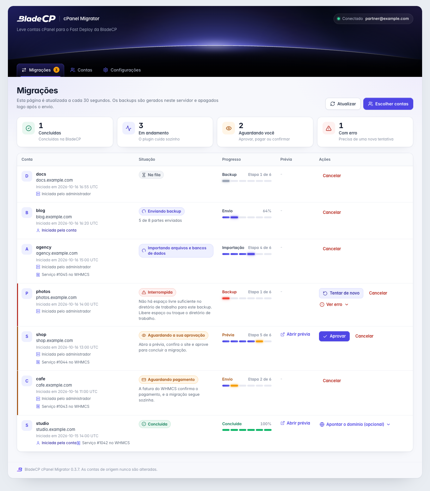
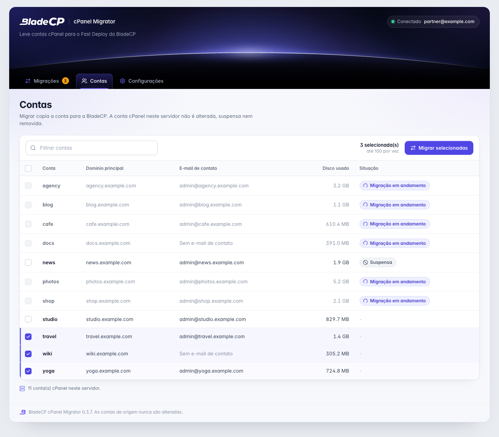
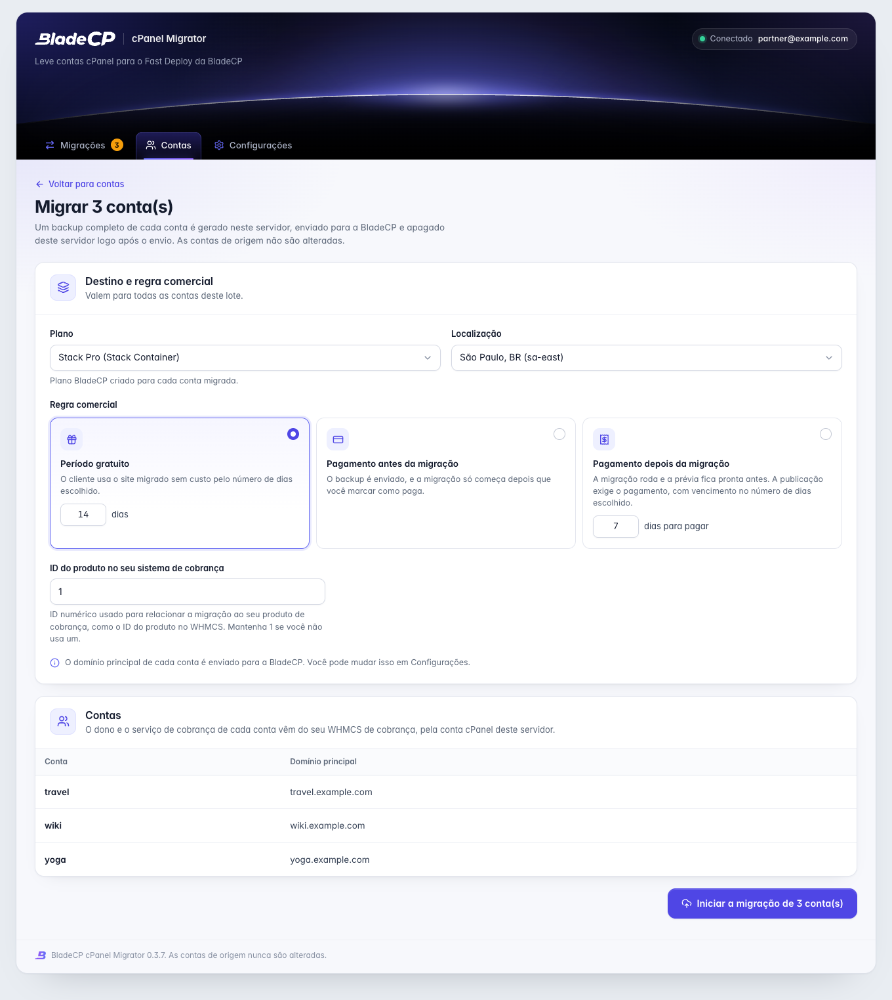
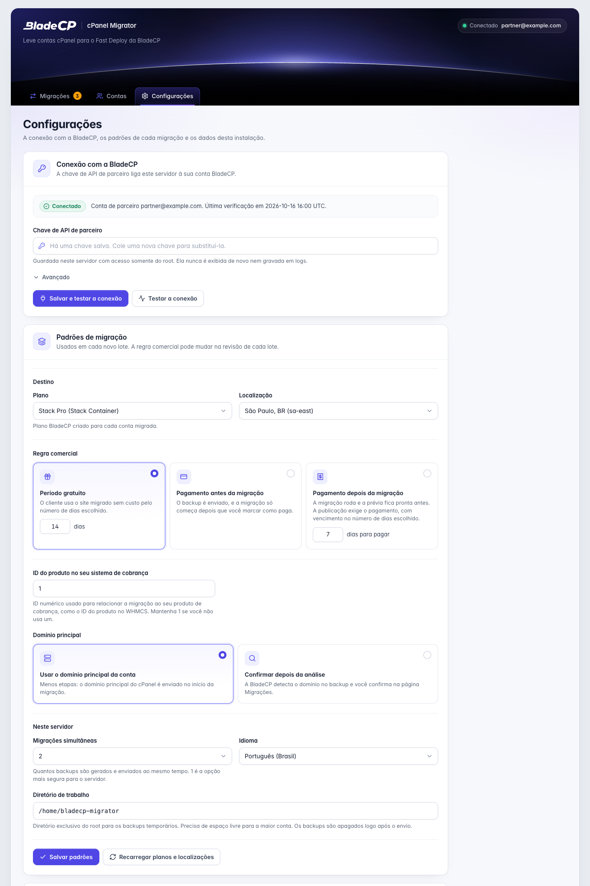
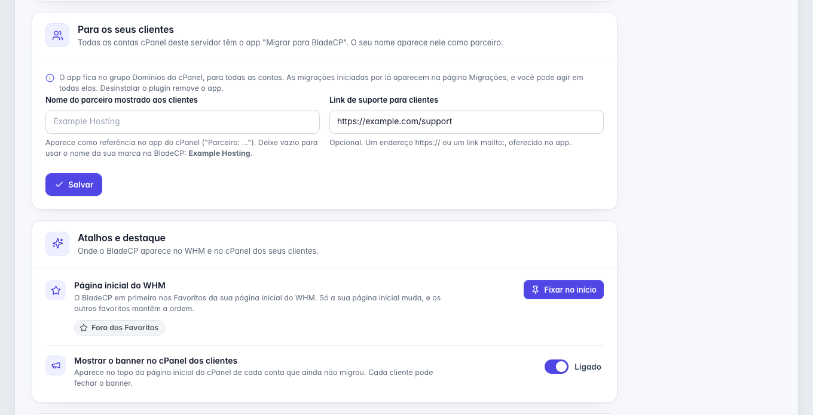
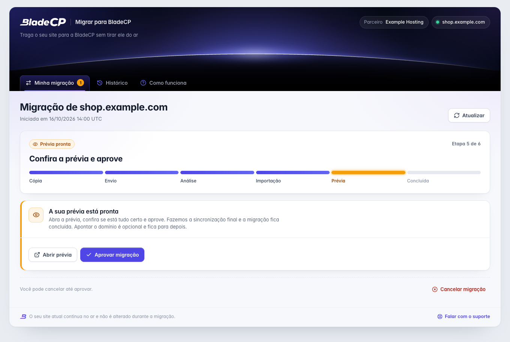

<p align="center">
  <picture>
    <source media="(max-width: 600px)" srcset="assets/hero-compact.pt-BR.svg">
    
  </picture>
</p>

<p align="center">
  <strong>Migre contas cPanel para a BladeCP pelo seu WHM, em lote ou pelo cPanel de cada cliente.</strong><br>
  O plugin oficial e open source que conecta o seu servidor cPanel e WHM à API de parceiros da BladeCP.
</p>

<p align="center">
  <a href="CHANGELOG.md"></a>
  <a href="#requisitos"></a>
  <a href="#requisitos"></a>
  <a href="#requisitos"></a><br>
  <a href="#qualidade"></a>
  <a href="CHANGELOG.md"></a>
  <a href="LICENSE"></a>
  <a href="https://github.com/bladecp/bladecp-cpanel/actions/workflows/ci.yml"></a>
</p>

<p align="center">
  <a href="https://github.com/bladecp/bladecp-cpanel/releases/download/v0.3.7/bladecp-cpanel-migrator-0.3.7.tar.gz"><strong>Baixar BladeCP cPanel Migrator (.tar.gz)</strong></a>
  &nbsp;·&nbsp;
  <a href="https://github.com/bladecp/bladecp-cpanel/releases/tag/v0.3.7">Notas da versão</a>
  &nbsp;·&nbsp;
  <a href="https://github.com/bladecp/bladecp-cpanel/releases/download/v0.3.7/SHA256SUMS">Checksum SHA-256</a>
</p>

<p align="center">
  <a href="#recursos">Recursos</a> ·
  <a href="#arquitetura">Arquitetura</a> ·
  <a href="#instalacao">Instalação</a> ·
  <a href="#configuracao">Configuração</a> ·
  <a href="#interface">Interface</a> ·
  <a href="#documentacao">Documentação</a> ·
  <a href="#seguranca">Segurança</a> ·
  <a href="#suporte">Suporte</a>
  <br>
  <sub><a href="README.md">English</a> · <a href="README.es.md">Español</a></sub>
</p>

> [!IMPORTANT]
> **Pré-release `0.3.7`.** Esta é a primeira versão pública. Instale primeiro
> num servidor cPanel e WHM fora de produção e migre uma conta de teste antes
> de levar contas de clientes.

O BladeCP cPanel Migrator é o plugin oficial e open source do WHM para
empresas de hospedagem parceiras da BladeCP. Ele leva contas cPanel do seu
servidor para o Fast Deploy da BladeCP: você escolhe as contas no WHM, ou os
seus clientes começam pelo próprio cPanel, e a BladeCP mostra uma prévia de
cada site antes de você aprovar.

A conta cPanel de origem nunca é alterada, suspensa nem removida. O plugin lê
a conta, gera o arquivo com o `pkgacct` e envia esse arquivo. A cobrança fica
no seu WHMCS, com o addon BladeCP.

<a id="recursos"></a>

## Feito para parceiros BladeCP

| Lotes pelo WHM | Um app em cada cPanel | Cobrança no seu WHMCS |
| --- | --- | --- |
| Selecione até 100 contas, escolha a regra comercial e acompanhe cada migração numa página só, com o link da prévia e a aprovação. | Os seus clientes levam o próprio site com o destino que você escolheu, pelo grupo **Domínios**, pela barra lateral ou por um banner na página inicial do cPanel. | O seu WHMCS de cobrança, com o addon BladeCP, acha o titular pela conta cPanel e vincula o serviço e a fatura. Ninguém digita e-mail. |

### O que acontece com cada conta

1. O plugin confere o espaço livre em disco.
2. Gera um backup completo da conta no servidor com o `pkgacct`.
3. Registra a migração na BladeCP com a sua chave de API de parceiro.
4. Envia o backup em partes, retomando de onde parou depois de uma interrupção.
5. Apaga o backup local logo após o envio.
6. Acompanha a migração e mostra o link da prévia, a revisão de domínio, a aprovação e a situação final.

### No WHM

- **Contas**: selecione as contas e clique em **Migrar selecionadas**, até 100 por vez. De uma a quatro migrações rodam ao mesmo tempo.
- **Migrações**: situação, progresso, link da prévia e as ações de cada migração, com quem a iniciou, o administrador ou a própria conta no cPanel.
- **Configurações**: a conexão com a BladeCP, os padrões de migração, o que os seus clientes veem e os atalhos do WHM.
- **Favoritos do WHM**: **Fixar no início** coloca o plugin em primeiro na sua página inicial do WHM e mantém os outros favoritos na ordem. O instalador não fixa nada.
- A busca do WHM por "transfer" ou "migrar" encontra **BladeCP: Migrar e Transferir Contas**, no idioma do servidor.

| Ação | Quando |
| --- | --- |
| **Confirmar domínio** | A BladeCP encontrou o domínio principal no backup e precisa da sua confirmação. |
| **Aprovar** | A prévia está pronta. Aprovar inicia a sincronização final, e a migração fica concluída. |
| **Marcar como paga** | Só em migrações criadas antes do vínculo com o WHMCS. Nas novas, a fatura do WHMCS confirma o pagamento. |
| **Tentar de novo** | A migração parou com erro, ou a BladeCP permite uma nova tentativa depois de uma falha. |
| **Cancelar** | Interrompe a migração na BladeCP (enquanto ainda pode ser cancelada) e apaga o backup local. |
| **Ver erro** | Mostra a mensagem, o código, a etapa e os detalhes do último erro. |

### No cPanel dos seus clientes

- Todas as contas ganham o app **Migrar para BladeCP**, com o ícone da BladeCP, no grupo **Domínios** e na barra lateral.
- Um banner discreto na página inicial do cPanel, "Traga o seu site para a BladeCP", leva ao app. Cada cliente pode fechá-lo de vez, e ele some quando a conta já migrou ou tem migração em andamento.
- O cliente inicia a migração da própria conta com o plano, o local, a regra comercial e o tratamento de domínio que você salvou. Uma migração por vez em cada conta.
- O app mostra as mesmas seis etapas do WHM, a prévia, a confirmação de domínio e a aprovação. Os erros aparecem em linguagem simples, com um código curto para o seu suporte.
- Quando o seu WHMCS ainda não conhece a conta, o app pede ao cliente para confirmá-la na sua área do cliente do WHMCS, numa aba nova, e segue sozinho.
- O cliente pode cancelar até aprovar. Pagamento e nova tentativa ficam com você, no WHM.

### Apontar o domínio é opcional

Depois da aprovação a migração fica **Concluída**. Apontar o domínio nunca é
uma etapa: **Apontar o domínio (opcional)** mostra os nameservers da BladeCP,
com botão de copiar, e o registro A como alternativa. Quando o domínio aponta,
a página mostra.

## Arquitetura

O plugin separa as telas em que você e os seus clientes agem, o trabalho que
roda a cada minuto e a comunicação com a BladeCP. A conta de origem é só lida
e arquivada.

<p align="center">
  <picture>
    <source media="(max-width: 600px)" srcset="assets/architecture-compact.pt-BR.svg">
    
  </picture>
</p>

<p align="center"><sub>Visão lógica do plugin. <a href="assets/architecture.pt-BR.svg">Abrir o diagrama em tamanho real</a>.</sub></p>

### Do WHM ao site migrado

1. **Você ou o seu cliente começam.** No WHM, só o `root` abre o plugin, e todo
   formulário leva um token CSRF ligado à sessão do WHM. No cPanel, a página
   do app roda como a conta e passa pela UAPI até um AdminBin que roda como
   root e age só na conta que o cPanel autenticou.
2. **A fila mantém a ordem.** Cada migração entra na fila com a sua própria
   trava. Um cron roda o worker a cada minuto, até quatro migrações ao mesmo
   tempo, e o worker mantém as marcas do banner de cada conta.
3. **O backup sai em partes.** O `pkgacct` grava um backup completo num
   diretório de trabalho só do root. O envio usa links assinados, retoma da
   primeira parte que faltou e apaga o backup ao terminar.
4. **A BladeCP monta a prévia.** O cliente da API chama `api.bladecp.com` por
   HTTPS com a sua chave de parceiro, acompanha a migração e traz o link da
   prévia, a revisão de domínio e a aprovação.
5. **A cobrança fica no seu WHMCS.** O addon BladeCP do seu WHMCS de cobrança
   vincula o titular, o serviço e a fatura. Apontar o domínio é opcional.

| Camada | Responsabilidade |
| --- | --- |
| **Plugin do WHM** | Contas, lotes, migrações, configurações e Favoritos do WHM, só para o `root` |
| **App do cPanel** | Página do Jupiter, módulo UAPI e AdminBin de root, limitado à conta logada |
| **Fila e worker** | Travas, retentativas, de uma a quatro migrações ao mesmo tempo e as marcas do banner |
| **Backup e envio** | Arquivo do `pkgacct`, checagem de espaço em disco e envio retomável por links assinados |
| **Cliente da API** | Chave de parceiro só no cabeçalho `Authorization`, com logs sem segredos |
| **Dados do plugin** | Diretório só do root com configurações, fila e logs |

<a id="downloads"></a>

## Downloads e notas da versão

**`0.3.7`** é a primeira versão pública. Ela é instalada a partir da release do
GitHub, com um arquivo determinístico conferido pelo checksum publicado, e o
período gratuito padrão passa a ser de 14 dias, como descrito no
[changelog](CHANGELOG.md). Leia as notas da versão antes de atualizar.

| Arquivo | Finalidade |
| --- | --- |
| [**bladecp-cpanel-migrator-0.3.7.tar.gz**](https://github.com/bladecp/bladecp-cpanel/releases/download/v0.3.7/bladecp-cpanel-migrator-0.3.7.tar.gz) | Pacote instalável, com `install.sh`, `uninstall.sh` e `plugin/` |
| [**SHA256SUMS**](https://github.com/bladecp/bladecp-cpanel/releases/download/v0.3.7/SHA256SUMS) | Checksum para conferir a integridade do arquivo |
| [**bladecp-cpanel-migrator-0.3.7.tar.gz.sha256**](https://github.com/bladecp/bladecp-cpanel/releases/download/v0.3.7/bladecp-cpanel-migrator-0.3.7.tar.gz.sha256) | O mesmo checksum, ao lado do nome do arquivo |
| [**RELEASE_NOTES.md**](https://github.com/bladecp/bladecp-cpanel/releases/download/v0.3.7/RELEASE_NOTES.md) | Notas que acompanham este pacote |

Veja a [página da release](https://github.com/bladecp/bladecp-cpanel/releases/tag/v0.3.7)
ou [todas as releases do BladeCP cPanel Migrator](https://github.com/bladecp/bladecp-cpanel/releases).
Os arquivos automáticos **Source code** do GitHub trazem o repositório; para
instalar o plugin, use o `.tar.gz` da lista acima.

<a id="requisitos"></a>

## Requisitos e compatibilidade

| Componente | Requisito |
| --- | --- |
| cPanel e WHM | Uma versão atual, com acesso root. O app do cPanel, o item da barra lateral e o banner da página inicial precisam do tema Jupiter. |
| PHP | O PHP que vem com o cPanel (`/usr/local/cpanel/3rdparty/bin/php`), 8.1 ou mais novo, com as extensões curl e json |
| Perl | O Perl que vem com o cPanel, para o módulo UAPI e o AdminBin |
| Sistema | O cron do sistema lendo `/etc/cron.d`, mais `pkgacct`, `setsid`, `nice` e `pkill` |
| Rede | HTTPS de saída para `api.bladecp.com` e para o armazenamento de backups da BladeCP |
| Disco | Espaço livre para a maior conta migrada de cada vez, mais 2 GB, no diretório de trabalho |
| Cobrança | O seu WHMCS de cobrança com o addon BladeCP |
| Idiomas | Inglês, português (Brasil) e espanhol, no WHM e no app do cPanel |

A versão `0.3.7` foi validada no cPanel e WHM 11.138 com AlmaLinux 9 e o PHP
8.4 que vem com o cPanel. São ambientes testados, não requisitos mínimos
adicionais.

Você também precisa de:

- Uma conta de parceiro BladeCP.
- Uma chave de API de parceiro com permissões de migração (`migrations:read` e
  `migrations:write`, ou `provisions:read` e `provisions:write`).
- Pelo menos um plano de parceiro que aceite migrações.

<a id="instalacao"></a>

## Instalação rápida

Instale a partir de uma [release do GitHub](https://github.com/bladecp/bladecp-cpanel/releases),
não de uma cópia do código-fonte. O servidor não precisa de Composer nem de
etapa de build.

1. Como root, baixe a release e o arquivo `SHA256SUMS`, confira o arquivo e
   rode o instalador:

   ```bash
   curl -fLO https://github.com/bladecp/bladecp-cpanel/releases/download/v0.3.7/bladecp-cpanel-migrator-0.3.7.tar.gz
   curl -fLO https://github.com/bladecp/bladecp-cpanel/releases/download/v0.3.7/SHA256SUMS
   sha256sum -c SHA256SUMS
   tar -xzf bladecp-cpanel-migrator-0.3.7.tar.gz
   cd bladecp-cpanel-migrator-0.3.7
   ./install.sh
   ```

   O `sha256sum -c SHA256SUMS` precisa mostrar `OK` para o arquivo.

2. Abra o WHM, vá em **Plugins** e escolha **BladeCP: Migrar e Transferir
   Contas**. O nome segue o idioma do servidor.
3. Abra **Configurações**, cole a sua chave de API de parceiro e salve os
   padrões de migração. Depois, migre uma conta de teste.

O instalador registra o plugin no WHM, cria um cron que roda a cada minuto,
instala o app do cPanel para o tema Jupiter e guarda configurações, fila e logs
em `/var/cpanel/bladecp-migrator`, só para o root. A lista completa de
caminhos está no [guia de instalação](docs/installation.md#what-the-installer-creates),
em inglês.

### Atualização e desinstalação

Baixe e confira a nova release, extraia o arquivo e rode o `install.sh` dela de
novo. As configurações, a chave de API e a fila de migrações são mantidas.

```bash
/usr/local/bladecp-migrator/uninstall.sh
```

A desinstalação remove os arquivos do plugin, o cron, o registro no WHM, o app
do cPanel com o item da barra lateral e o banner, e os backups temporários.
Acrescente `--purge` para remover também as configurações, o histórico de
migrações e a chave de API. Ela nunca remove um include de outro sistema e não
cancela migrações que já estão em andamento na BladeCP.

<a id="configuracao"></a>

## Configuração

Abra **Configurações** no plugin.

| Seção | O que você define |
| --- | --- |
| **Conexão com a BladeCP** | Cole a chave de API de parceiro e clique em **Salvar e testar a conexão**. O plugin mostra a conta de parceiro conectada. |
| **Padrões de migração** | Plano e localização, regra comercial, ID do produto no seu sistema de cobrança, tratamento do domínio principal, migrações simultâneas (de 1 a 4), diretório de trabalho e idioma |
| **Para os seus clientes** | O nome do parceiro que o app do cPanel mostra como referência e um link de suporte opcional |
| **Atalhos e destaque** | Fixar o plugin nos Favoritos do WHM, e mostrar ou esconder o banner no cPanel dos seus clientes |

A chave fica num arquivo só do root, com modo 0600, nunca é exibida de novo e
nunca é gravada em logs. Deixe vazia a URL personalizada da API em
**Avançado**, a não ser que o suporte da BladeCP peça para alterar.

### Regras comerciais

| Regra | Comportamento |
| --- | --- |
| **Período gratuito** | A migração vai até a prévia e pode ser aprovada na hora. O cliente tem o número de dias gratuitos escolhido, 14 por padrão. |
| **Pagamento antes da migração** | O backup é enviado, mas a migração só começa depois que a fatura do WHMCS for paga. |
| **Pagamento depois da migração** | A migração vai até a prévia. A aprovação exige a fatura do WHMCS paga, com vencimento no número de dias escolhido. |

Você pode mudar a regra em cada migração. O
[guia de configuração](docs/configuration.md), em inglês, cobre cada campo e a
linha de comando.

<a id="interface"></a>

## Veja no WHM e no cPanel

<p align="center">
  
</p>

<p align="center"><sub>Migrações no WHM: cada conta com a etapa, o link da prévia e a ação que ela pede.</sub></p>

| Contas, com três selecionadas | Revisão do lote |
| --- | --- |
|  |  |

| Configurações: conexão e padrões de migração | Configurações: clientes, atalhos e destaque |
| --- | --- |
|  |  |

| App do cPanel: antes da migração | App do cPanel: prévia pronta para aprovar |
| --- | --- |
|  |  |

<p align="center">
  
</p>

<p align="center"><sub>O banner no topo da página inicial do cPanel, até a conta migrar ou o cliente fechar.</sub></p>

As capturas vêm do código do plugin `0.3.7`, renderizado com dados neutros de
demonstração, como `example.com`, e com os estilos do tema Jupiter do cPanel em
volta do banner. Num servidor, as mesmas telas abrem dentro do WHM e do cPanel.

### Onde ele aparece

| Lugar | O que você e os seus clientes veem |
| --- | --- |
| **WHM → Plugins** | **BladeCP: Migrar e Transferir Contas**, com o ícone da BladeCP, também encontrado pela busca do WHM |
| **Página inicial do WHM** | O plugin em primeiro nos seus Favoritos, quando você escolhe **Fixar no início** |
| **Páginas do plugin** | **Contas**, **Migrações** e **Configurações**, sob o cabeçalho com o horizonte BladeCP |
| **cPanel → Domínios** | O app **Migrar para BladeCP**, com o ícone da BladeCP |
| **Barra lateral do cPanel** | O mesmo app, com o "B" da BladeCP na cor dos ícones nativos do menu |
| **Página inicial do cPanel** | O banner "Traga o seu site para a BladeCP" com **Migrar agora**, até a conta migrar ou o cliente fechar |

Cada tela segue o idioma do servidor ou da conta cPanel, em inglês, português
(Brasil) ou espanhol, e respeita a preferência por menos movimento.

<a id="documentacao"></a>

## Documentação

Os guias estão em inglês.

| Guia | O que você encontra |
| --- | --- |
| [Instalação](docs/installation.md) | Download, checksum, caminhos do instalador, atualização e desinstalação |
| [Configuração](docs/configuration.md) | Conexão, padrões de migração, regras comerciais, atalhos e linha de comando |
| [Compatibilidade](docs/compatibility.md) | Requisitos, ambiente validado e o que ainda não é suportado |
| [Solução de problemas](docs/troubleshooting.md) | Worker, conexão, planos, migrações paradas, app do cPanel e logs |
| [Processo de release](docs/release-process.md) | Como as versões públicas são preparadas e conferidas |
| [Governança do repositório](docs/repository-governance.md) | Issues, pull requests, histórico e releases |
| [Changelog](CHANGELOG.md) | Mudanças de cada versão |
| [Política de segurança](SECURITY.md) | Relato privado de vulnerabilidades |
| [Como contribuir](CONTRIBUTING.md) | Como propor e validar uma mudança |

<a id="seguranca"></a>

## Segurança

- **Só o root no WHM.** Só o usuário `root` do WHM abre o plugin. Todo
  formulário é protegido pelo token de sessão do WHM e por um token CSRF
  ligado a essa sessão, e requisições de outra origem são recusadas.
- **Uma conta por cliente.** O app do cPanel não guarda segredo. Toda ação
  passa pela UAPI até um AdminBin que age só na conta que o cPanel autenticou,
  nunca num nome enviado pela página. As requisições têm limite por conta, e
  os inícios e ações ficam no log.
- **Um lugar para a chave.** A chave de API de parceiro fica guardada só para o
  root, é enviada apenas no cabeçalho `Authorization` e é removida de logs e
  detalhes de erro.
- **Backups de vida curta.** Os backups vão para um diretório só do root e são
  apagados logo após o envio bem-sucedido, no cancelamento e na desinstalação.
- **A origem fica intacta.** O plugin nunca altera, suspende nem remove a conta
  de origem.

Para relatar uma vulnerabilidade de forma privada, siga o
[SECURITY.md](SECURITY.md). Não inclua chaves de API, backups ou dados de
clientes numa issue pública.

<a id="qualidade"></a>

## Qualidade e validação

A versão `0.3.7` foi validada pelos mantenedores com **769 verificações
automatizadas**: 649 verificações unitárias e de cenário da fila, do worker,
do envio, do cliente da API, das configurações, das telas do WHM e do cPanel e
da remoção de segredos, 18 verificações em Perl do módulo UAPI e do AdminBin,
81 verificações de instalação e desinstalação numa raiz de sistema simulada e
as 21 verificações públicas de regressão. O badge de testes representa essa
execução.

Antes de o pacote ser gerado, todo arquivo PHP passa por checagem de sintaxe e
a árvore pública é varrida em busca de credenciais e referências não públicas.
O arquivo da release foi então instalado do zero num servidor cPanel e WHM
11.138, conectado, desinstalado sem resíduos e instalado de novo.

Este repositório traz as próprias verificações de regressão (`tests/run.php`),
as verificações de Perl e de instalação (`tests/perl/run.sh` e
`tests/install/run.sh`) e a checagem de estrutura e higiene
(`scripts/check-public-tree.sh`). O
[CI público](https://github.com/bladecp/bladecp-cpanel/actions/workflows/ci.yml)
roda tudo isso no PHP 8.1, 8.2, 8.3 e 8.4. Verificações automatizadas não
substituem um teste no seu próprio servidor antes do uso com clientes.

<a id="desenvolvimento"></a>

## Desenvolvimento e contribuição

O plugin é PHP 8.1 puro, com autoloader nativo: não há etapa de build nem
dependência de Composer.

```sh
git clone https://github.com/bladecp/bladecp-cpanel.git
cd bladecp-cpanel
find plugin tests -type f \( -name '*.php' -o -name '*.cgi' \) -print0 | xargs -0 -n1 php -l
php tests/run.php
bash tests/perl/run.sh
PHP=php bash tests/install/run.sh
bash scripts/check-public-tree.sh
```

```text
plugin/
  src/                Fila, worker, envio, cliente da API, telas do WHM e backend do app do cPanel
  cgi/                Ponto de entrada no WHM
  bin/                Worker e o comando privilegiado do app do cPanel
  cpanel/             App do cPanel: página do Jupiter, módulo UAPI, AdminBin e item de menu
  lang/               Inglês, português (Brasil) e espanhol
  assets/             Estilos, ícones e a fonte Inter
install.sh            Instalador e atualizador
uninstall.sh          Desinstalador (--purge remove também os dados)
tests/                Verificações públicas de regressão, Perl e instalação
scripts/              Checagem pública de estrutura e higiene
docs/                 Guias de instalação, configuração e operação
assets/               Arte, capturas de tela e marcas do README
```

Contribuições são bem-vindas. Leia o [CONTRIBUTING.md](CONTRIBUTING.md) antes
de abrir uma issue ou um pull request, mantenha as mudanças focadas, adicione
a cobertura pertinente e nunca envie credenciais nem dados de clientes. As
contribuições aprovadas seguem o fluxo de manutenção do projeto antes de
aparecerem numa versão pública posterior.

<a id="perguntas"></a>

## Perguntas frequentes

<details>
<summary><strong>O plugin altera a conta de origem?</strong></summary>

Não. Ele lê a conta e gera o arquivo com o `pkgacct`. A conta nunca é
alterada, suspensa nem removida, e o backup local é apagado após o envio.

</details>

<details>
<summary><strong>Preciso de Composer ou de etapa de build no servidor?</strong></summary>

Não. O `.tar.gz` traz `install.sh`, `uninstall.sh` e `plugin/`. Rode o
instalador como root e o plugin fica pronto para configurar.

</details>

<details>
<summary><strong>Os meus clientes podem iniciar uma migração sozinhos?</strong></summary>

Sim, pelo app **Migrar para BladeCP** no cPanel deles, com os padrões que você
salvou. Cada conta vê e age só na própria migração. Para esconder o app de uma
conta, desligue a feature `site_migration` no Feature Manager.

</details>

<details>
<summary><strong>E se o envio for interrompido?</strong></summary>

Nada a fazer. A próxima tentativa retoma da primeira parte que faltou.

</details>

<details>
<summary><strong>Quem cobra o cliente migrado?</strong></summary>

Você, no seu WHMCS. O addon BladeCP acha o titular pela conta cPanel e vincula
o serviço e a fatura. Com **Pagamento antes da migração** ou **Pagamento
depois da migração**, a fatura do WHMCS confirma o pagamento.

</details>

<details>
<summary><strong>A migração espera o apontamento do domínio?</strong></summary>

Não. A migração fica concluída quando você aprova a prévia. Apontar o domínio,
pelos nameservers da BladeCP ou por um registro A, é opcional.

</details>

<a id="suporte"></a>

## Suporte

| Assunto | Canal |
| --- | --- |
| Bug reproduzível ou pedido de produto | [GitHub Issues](https://github.com/bladecp/bladecp-cpanel/issues) |
| Suporte técnico e de produto | [dev@bladecp.com](mailto:dev@bladecp.com) |
| Vulnerabilidade | [Política de segurança](SECURITY.md) |
| Documentação online | [developers.bladecp.com](https://developers.bladecp.com/pt-BR/cpanel-migrator) |

Em relatos públicos, use dados neutros, como `example.com`. Mantenha chaves de
API, backups e informações de clientes em canais privados.

## Licença

O BladeCP cPanel Migrator é distribuído sob a [Licença MIT](LICENSE). A fonte
Inter em `plugin/assets/fonts` mantém a sua própria
[SIL Open Font License](plugin/assets/fonts/LICENSE.txt). A licença do plugin
não substitui a licença do cPanel e WHM nem os termos dos serviços BladeCP.

<p align="center"><strong>BladeCP. Sua loja, nossa infraestrutura.</strong></p>
